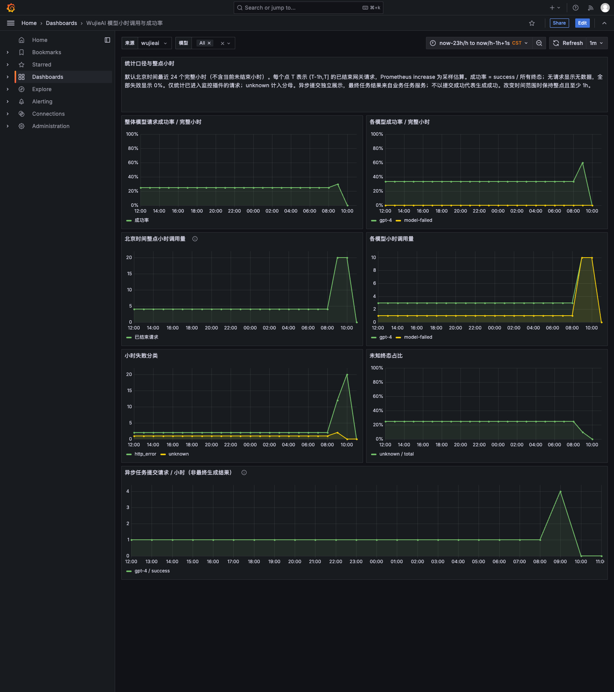

# 2026-11-05 远程 Grafana 浏览器验证

OPE-11003 / OPE-9626，基线 `e8c361eb`。本轮只在 Mac 打包机
`wujieai-mac-pkg-34`、Docker context `colima-ope10117` 执行。未在用户本机运行
容器或浏览器，没有正式发布、线上配置、私服发布或外部业务渠道动作。

## 结果

| 项目 | 实测结果 |
|---|---|
| Grafana 11.3.0 arm64 | 实际导入仓库 dashboard.json，`DS_PROMETHEUS` 映射到真实 Prometheus 2.55.1 数据源；关闭匿名访问；浏览器通过真实表单登录 |
| Native Chrome 156 | 单实例、独立 profile；50 项浏览器断言通过，0 浏览器运行异常；7 个实际图表画布及未加工截图已视觉复核 |
| 默认来源/模型/单位 | 默认 wujieai / All；count 为 short，成功率和 unknown 为 percentunit；分模型筛选作用于实际查询 |
| 已知小时结果 | 整体30%、gpt-4 60%、unknown占比10%、纯失败模型和全失败小时0%；无增量小时没有成功率值；无系列小时显示无数据 |
| 小时窗口 | 同一浏览器对比：旧默认25个桶，修正后24个桶；最后一个点均为当前小时起点H，当前未完成小时没有纳入；管理端编码URL同样返回24个桶 |
| 实时网关链路 | 8 次真实 Wasm/Envoy HTTP/SSE 探测，success/stream_error/unknown 每次计数增量为1；真实 Prometheus target/relabel/federation及7条看板表达式通过 |
| 定向断连 | fixture专用3s超时路由，收到完整首SSE事件才主动close；3/3为interrupted一次，timeout/success/unknown增量均0；生产monitor判定未改 |

数据和断言详见 [report.json](report.json)。完整查询、DOM、日志与各次尝试在本地
`/private/tmp/ope-9626-grafana-results-20261105`，远程归档为
`/Users/wujieai/ope9626-validation/higress/20261104-ope11003/runtime/grafana/results-grafana-20261105.tar.gz`。

## 小时范围修正与证据

实际 Grafana11.3 请求会把 `/h` 上界按 `roundUp` 解析到该小时末尾。
原始 `from=now-24h/h&to=now/h` 的后端1h查询，端点从 **H-24h至H**，包容两端，
实测25个桶。最后一个点是H，代表 `(H-1h,H]`，因此原先“包含当前未完成小时”的
推断不成立；已证实的问题是左端额外包含 `(H-25h,H-24h]`。

修正后的看板默认值为：

```json
{"from":"now-23h/h","to":"now/h-1h+1s"}
```

实际原始上界为 **H+999ms**；固定1h步长的最后一个查询点仍为 **H**。从
**H-23h至H** 恰好24个端点，窗口合起来为 `(H-24h,H]`。结束参数中的1s补偿是为了
避免直接减1h得到H-1ms、进而漏掉刚完成的小时。比较数据含26小时连续历史，验证了
原25点、现24点、首尾时间、最近完成小时保留及无未来/当前不完整小时点，未以放宽
取模断言替代验证。

管理端可使用看板默认范围，或使用下列相对URL参数：

```text
/d/wujie-model-requests?var-source=wujieai&from=now-23h%2Fh&to=now%2Fh-1h%2B1s&timezone=Asia%2FShanghai
```

`+` 必须编码为 `%2B`。旧的显式from/to会覆盖新默认范围，需要更新入口配置。
契约已同步为v7；本任务没有编辑兄弟仓库。指标名、来源、模型与终态契约不变。

## 真实服务与测试数据边界

页面、登录、数据源、Prometheus查询、图表绘制和截图均来自真实 Grafana/Chrome，
没有伪造页面、替换浏览器响应或生成mock图片。

实时链路为真实Higress/Wasm → 真实Envoy导出 → 真实Prometheus；上游提供方和计费报告
接收端仍是合成fixture，不是部署后的客户端或账务服务。默认看板只展示完整历史小时，
所以历史显示另外使用 `job=hour-fixture` 的明确合成计数器，由真实promtool导入任务TSDB。
它包含26小时旧数据及混合、全失败、无增量和缺失小时，验证计算与显示，**不是业务历史或账本**。
实时请求属于 `job=higress-fixture`，保留在当前小时并单独验证。

最后一轮为隔离的Prometheus+Grafana渲染检查，复用已通过的完整链路证据；没有把无网关
的渲染轮称为实时target验收。空历史范围没有label_values候选时，来源选择框可能为空；
wujieai默认值是在有可采集系列的默认范围验证的，本轮未扩大变量行为设计。

## 初轮失败和修正

1. 较旧的完整网关矩阵20/21通过；断连请求在首事件前先收到504，被正确分类timeout。
   保留失败记录，随后仅为fixture增加专用3s路由、等待完整首事件后close，3次定向重跑通过。
2. 原始结束毫秒必须整除1h的断言失败。补查实际时间/值后确认Grafana包容上界，以及独立的
   左端25桶问题；后者有真实baseline/candidate对比并作最小看板范围修复。
3. 首次截图仅导航栏，后一次出现Retina/原生窗口和仿真viewport不一致的裁切。这些图没有
   当作渲染成功。统一原生窗口1600×1800、viewport与scale1、激活焦点/绘制后，保留未加工
   compositor截图；默认图表、失败模型和空小时的完整画面已复核。操作只影响验证Chrome。

## 资源与回收

完整四容器配额总计 **2CPU/2048MiB**；最后渲染两容器 **0.85CPU/896MiB**，串行执行。
端口均仅绑定127.0.0.1。复用既有Higress/Prometheus/Python与Native Chrome/Node，
只新增Grafana镜像，没有npm依赖树或浏览器下载。

Node heap128MiB、renderer V8 heap256MiB、renderer并发上限2。Native进程RSS采样合计最高
1489.3MiB，包含共享页重复计量，不能视为硬内存上限或物理峰值。容器预算不包含Native
进程；主机空闲内存最低60%、磁盘最低21.26GiB、1分钟load最高3.28，没有触发压力停止。

已确认任务容器/网络/卷均不存在，Node、Chrome及其任务助手退出；随机口令、profile、
任务TSDB已删除。仅保留原有受保护的 `ope10762-real-squad-db`，未操作它。
共享时段已completed/released，nextOwner=OPE-11002。详细数据见report.json.resources。

## 仍未验收

正式集群的Operator发现、pilot-agent15020合并、实际生产filter chain、其他协议转换器、
真实多Pod重启、容量/启动/p99/首token，以及实际客户端/任务服务/账务/Kafka/数据库或外部
渠道部署联调。OPE-11003保持in_progress；本轮详细记录仅保存在本地和共享协调目录。

## 未加工浏览器截图

[登录页](01-login.png) · [原范围25桶](02-baseline-hours.png) ·
[修正后24桶](03-default-hours.png) · [失败模型](05-failed-model.png) ·
[空小时无数据](06-absent-hour.png)


